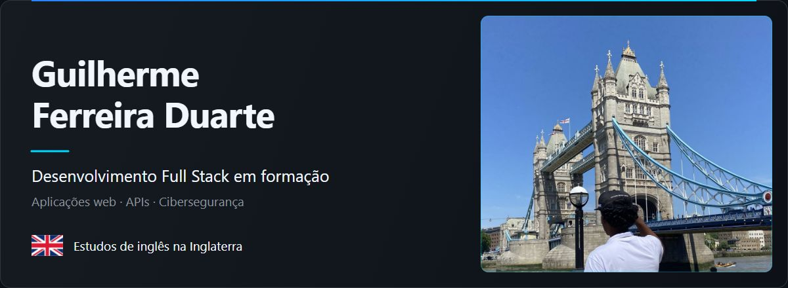

<picture>
  <source media="(max-width: 600px)" srcset="assets/header-mobile.jpg">
  
</picture>

Estudo programação e desenvolvo projetos para colocar em prática o que aprendo. Tenho interesse em desenvolvimento web, APIs e cibersegurança.

## Sobre mim

Estudo na Escola do Futuro e faço cursos pela DIO. Reúno aqui projetos de estudo e aplicações que venho desenvolvendo, incluindo sistemas web, APIs e e-commerce.

## Tecnologias

`JavaScript` · `TypeScript` · `HTML` · `CSS`

## Formação e certificados

### DIO — 26 certificados

Programação e desenvolvimento de aplicações, com estudos de Node.js, TypeScript e APIs.

**Escola do Futuro** — estudos em andamento.

**Inglês** — curso na Inglaterra e certificado de proficiência.

[Certificado de API](https://hermes.dio.me/certificates/XMK5XAEH.pdf) · [Certificado de TypeScript](https://hermes.dio.me/certificates/7VR7JOUE.pdf) · [Certificado do carrinho](https://hermes.dio.me/certificates/IBEREGDE.pdf)

[Ver a lista completa dos 26 certificados](certificados.md)
